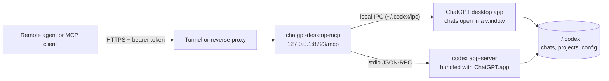

# chatgpt-desktop-mcp

An MCP server that lets other agents work with the Codex chats in the **ChatGPT desktop app on your Mac**: list and read conversations, start new chats in your projects, send follow-ups, pick the model, reasoning effort, and speed, steer or interrupt running work, and answer approvals. It runs locally and can be exposed to the internet behind bearer tokens, so a remote agent can monitor and drive your Codex work.

Chats created this way show up in the app's sidebar, and messages sent to a chat that is open in the app appear live in its window.

> **Unofficial.** Not affiliated with OpenAI. It combines the documented Codex app-server protocol with the desktop app's local IPC channel, which is internal and can change when the app updates. Run `chatgpt-desktop-mcp doctor` after updating the app.

## How it works



The bridge routes each request to the right place:

- **Chats open in a ChatGPT window** are driven through the app itself, the same way the app's own surfaces coordinate. Messages, model changes, steering, and interrupts appear live in the window.
- **Everything else** (listing, history, model catalog, new chats, chats not open in the app) goes through a private `codex app-server` started from the binary bundled inside ChatGPT.app. It shares `~/.codex` with the app, so it sees the same chats, projects, sign-in, MCP servers, and settings.

Codex lets only one process write to a chat at a time. The process that runs bridge turns exits about two seconds after its last turn so the app can open those chats again.

## Requirements

- macOS with the ChatGPT desktop app and Codex. Verified with ChatGPT 26.1027.30824 (bundled Codex 0.166.0-alpha.5.1).
- Node.js 22 or newer.
- Optional: [`cloudflared`](https://developers.cloudflare.com/cloudflare-one/connections/connect-networks/downloads/) for `--tunnel` (`brew install cloudflared`).

## Install

```sh
npm install -g github:kevinrss01/chatgpt-desktop-mcp
chatgpt-desktop-mcp doctor
```

The compiled CLI is committed in `dist/`, so installing from GitHub needs no build step. From a clone: `npm install && npm link`.

## Quick start

```sh
# 1. Create a token. It is printed once; only its SHA-256 digest is stored.
chatgpt-desktop-mcp token create --name my-agent --scope control

# 2. Serve MCP on http://127.0.0.1:8723/mcp
chatgpt-desktop-mcp serve

# Or also publish it on a temporary public HTTPS URL
chatgpt-desktop-mcp serve --tunnel
```

Every request needs `Authorization: Bearer <token>`. Tokens have one of two scopes:

| Scope | Tools |
| --- | --- |
| `read` | `list_models`, `list_projects`, `list_chats`, `read_chat`, `get_chat_status`, `wait_for_chat`, `list_pending_requests` |
| `control` | Everything in `read`, plus `create_chat`, `send_message`, `interrupt_chat`, `rename_chat`, `archive_chat`, `respond_to_request` |

Manage tokens with `chatgpt-desktop-mcp token list` and `chatgpt-desktop-mcp token revoke <id-or-name>`.

## Connect an agent

**Claude Code**

```sh
claude mcp add --transport http chatgpt-desktop https://YOUR-HOST/mcp --header "Authorization: Bearer $CDM_TOKEN"
```

**Codex CLI** (`~/.codex/config.toml`)

```toml
[mcp_servers.chatgpt_desktop]
url = "https://YOUR-HOST/mcp"
bearer_token_env_var = "CDM_TOKEN"
```

**OpenAI Responses API**

```js
const response = await openai.responses.create({
  model: 'gpt-6.1-sol',
  input: 'Check my Codex chats and summarize what is still running.',
  tools: [
    {
      type: 'mcp',
      server_label: 'chatgpt_desktop',
      server_url: 'https://YOUR-HOST/mcp',
      headers: { Authorization: `Bearer ${process.env.CDM_TOKEN}` },
      require_approval: 'never',
    },
  ],
});
```

**Local stdio clients** (no token; the client launches the server):

```json
{ "mcpServers": { "chatgpt-desktop": { "command": "chatgpt-desktop-mcp", "args": ["stdio"] } } }
```

Add `"--read-only"` to the args for a monitoring-only setup. ChatGPT custom connectors require OAuth, which this server does not implement yet.

To try tools from a terminal: `CDM_URL=http://127.0.0.1:8723/mcp CDM_TOKEN=... node scripts/call-tool.mjs list_chats '{"limit":5}'`.

## Tools

| Tool | What it does |
| --- | --- |
| `list_models` | Models available to the app with their reasoning efforts and speed tiers. |
| `list_projects` | Projects saved in the app, plus folders used by recent chats. |
| `list_chats` | Chats sorted by last activity; filter by project, search text, or archived state. |
| `read_chat` | The latest turns of a chat in order: messages, plus one-line summaries of commands, edits, and tool calls. Page back with `olderCursor`. |
| `get_chat_status` | Whether the chat is running and where (`app`, `bridge`, or `stored`), its model, effort, and speed, pending approvals, and the latest assistant message. |
| `wait_for_chat` | Waits until the chat stops running (up to 300 s), then returns its status. |
| `create_chat` | Starts a chat in a project (or a new folder under `~/Documents/Codex/<date>/`, as the app does) with an optional first prompt, model, effort, speed, sandbox, and approval policy. |
| `send_message` | Sends a follow-up. If the chat is busy, `whenBusy` chooses to reject, steer the running turn, or interrupt it first. |
| `interrupt_chat` | Stops the running turn. |
| `rename_chat`, `archive_chat` | Retitle, archive, or restore a chat. |
| `list_pending_requests`, `respond_to_request` | See and answer command, file, question, and MCP approval requests from chats the bridge runs. |

**Model, effort, and speed.** `list_models` returns valid values. `speed` accepts `standard`, a tier id such as `priority` or `ultrafast`, or a tier name such as `Fast`. For a chat open in the app, a model or effort change is applied for the next turn, as the app's model picker does.

A typical monitoring loop: `list_chats` to see what changed, `get_chat_status` for live state, `wait_for_chat` until a run ends, then `read_chat` for the transcript.

## Exposing it safely

A control token lets the holder make Codex run commands on your Mac with the permissions in your Codex configuration. Treat it like SSH access.

- The server listens on `127.0.0.1` by default. Publish it through a TLS tunnel or reverse proxy; do not bind it to a public interface.
- `--tunnel` starts a Cloudflare quick tunnel. Its URL is random and changes on every start, which suits testing. For a stable address use a [named Cloudflare tunnel](https://developers.cloudflare.com/cloudflare-one/connections/connect-networks/), Tailscale Funnel, or your own proxy pointing at `http://127.0.0.1:8723`.
- Give monitoring agents `read` tokens. Revoke tokens you no longer use.
- Requests carrying a browser `Origin` header are rejected unless allowed with `--allow-origin`, which also enables CORS for that origin. Repeated failed authentication from one client returns 429.
- To restrict chats the bridge starts or resumes, run with `--sandbox workspace-write --approval-policy on-request` and answer approvals with `respond_to_request`. Callers cannot loosen these settings through tool arguments. Chats open in the app keep the app's own settings.

## Run at login (launchd)

Save as `~/Library/LaunchAgents/com.github.chatgpt-desktop-mcp.plist`, adjusting the paths from `which node` and `which chatgpt-desktop-mcp`, then run `launchctl load ~/Library/LaunchAgents/com.github.chatgpt-desktop-mcp.plist`:

```xml
<?xml version="1.0" encoding="UTF-8"?>
<!DOCTYPE plist PUBLIC "-//Apple//DTD PLIST 1.0//EN" "http://www.apple.com/DTDs/PropertyList-1.0.dtd">
<plist version="1.0">
<dict>
  <key>Label</key><string>com.github.chatgpt-desktop-mcp</string>
  <key>ProgramArguments</key>
  <array>
    <string>/opt/homebrew/bin/node</string>
    <string>/opt/homebrew/bin/chatgpt-desktop-mcp</string>
    <string>serve</string>
  </array>
  <key>RunAtLoad</key><true/>
  <key>KeepAlive</key><true/>
  <key>StandardErrorPath</key><string>/tmp/chatgpt-desktop-mcp.log</string>
</dict>
</plist>
```

Pair it with a named tunnel service so the public URL stays the same across restarts.

## Limitations

- macOS only. Live control of open chats relies on the app's internal IPC messages and may need an update after a ChatGPT release; the background engine keeps working in that case.
- When a chat is not open in the app, the app's router needs about 10 seconds to confirm that before the bridge runs the message in its background engine. Messages to open chats are delivered immediately.
- While the bridge is running a turn in a chat that is not open in the app, the app can show that chat but cannot continue it until the turn ends.
- Renaming or archiving a chat that the app currently has loaded is refused; do it in the app.
- Approvals for runs inside the app are answered in the app; `get_chat_status` shows that one is waiting.
- Messages are text only. Regular ChatGPT conversations outside Codex are stored in your ChatGPT account, not in `~/.codex`, and are not covered.

## Development

```sh
npm install
npm test          # unit and protocol tests (no app needed)
npm run build     # rebuild dist/ and commit it with your change
node dist/cli.js serve --verbose
```

The tests cover the IPC framing and a fake desktop router, token storage, model option resolution, history formatting, live-state parsing, and HTTP authentication and scopes through a real MCP client.

## License

[MIT](LICENSE)
