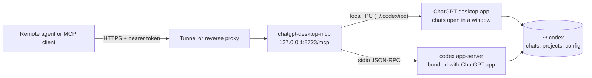

# chatgpt-desktop-mcp

An MCP server that lets other agents work with the Codex chats in the **ChatGPT desktop app on your Mac**: list and read conversations, start new chats in your projects, send follow-ups, pick the model, reasoning effort, and speed, steer or interrupt running work, and answer approvals. It runs locally and can be exposed to the internet behind bearer tokens, so a remote agent can monitor and drive your Codex work.

Chats created this way show up in the app's sidebar, and messages sent to a chat that is open in the app appear live in its window.

> **Unofficial.** Not affiliated with OpenAI. It combines the documented Codex app-server protocol with the desktop app's local IPC channel, which is internal and can change when the app updates. Run `chatgpt-desktop-mcp doctor` after updating the app.

## How it works



The bridge routes each request to the right place:

- **Chats open in a ChatGPT window** are driven through the app itself, the same way the app's own surfaces coordinate. Messages, model changes, steering, and interrupts appear live in the window.
- **Everything else** (listing, history, model catalog, new chats, chats not open in the app) goes through a private `codex app-server` started from the binary bundled inside ChatGPT.app. It shares `~/.codex` with the app, so it sees the same chats, projects, sign-in, MCP servers, and settings.

Codex lets only one process write to a chat at a time. The process that runs bridge turns exits about two seconds after its last turn so the app can open those chats again.

## Requirements

- macOS with the ChatGPT desktop app and Codex. Verified with ChatGPT 26.1027.30824 (bundled Codex 0.166.0-alpha.5.1).
- Node.js 22 or newer.
- Optional: [`cloudflared`](https://developers.cloudflare.com/cloudflare-one/connections/connect-networks/downloads/) for a public URL (`brew install cloudflared`). A fixed URL also needs a domain on Cloudflare.

## Install

```sh
npm install -g https://github.com/kevinrss01/chatgpt-desktop-mcp/tarball/main
chatgpt-desktop-mcp doctor
```

The compiled CLI is committed in `dist/`, so installing from GitHub needs no build step. To pin a release, replace `main` with a tag such as `v0.3.0`. From a clone: `npm install && npm link`.

## Quick start

```sh
# 1. Create a token. It is printed once; only its SHA-256 digest is stored.
chatgpt-desktop-mcp token create --name my-agent --scope control

# 2. Serve MCP on http://127.0.0.1:8723/mcp
chatgpt-desktop-mcp serve

# Or also publish it on a temporary public HTTPS URL
chatgpt-desktop-mcp serve --tunnel
```

Every request needs `Authorization: Bearer <token>`. Tokens have one of two scopes:

| Scope | Tools |
| --- | --- |
| `read` | `list_models`, `list_projects`, `list_chats`, `read_chat`, `get_chat_status`, `wait_for_chat`, `list_pending_requests` |
| `control` | Everything in `read`, plus `create_chat`, `send_message`, `interrupt_chat`, `rename_chat`, `archive_chat`, `respond_to_request` |

Manage tokens with `chatgpt-desktop-mcp token list` and `chatgpt-desktop-mcp token revoke <id-or-name>`.

## Connect an agent

**Claude Code**

```sh
claude mcp add --transport http chatgpt-desktop https://YOUR-HOST/mcp --header "Authorization: Bearer $CDM_TOKEN"
```

**Codex CLI** (`~/.codex/config.toml`)

```toml
[mcp_servers.chatgpt_desktop]
url = "https://YOUR-HOST/mcp"
bearer_token_env_var = "CDM_TOKEN"
```

**OpenAI Responses API**

```js
const response = await openai.responses.create({
  model: 'gpt-6.1-sol',
  input: 'Check my Codex chats and summarize what is still running.',
  tools: [
    {
      type: 'mcp',
      server_label: 'chatgpt_desktop',
      server_url: 'https://YOUR-HOST/mcp',
      headers: { Authorization: `Bearer ${process.env.CDM_TOKEN}` },
      require_approval: 'never',
    },
  ],
});
```

**Local stdio clients** (no token; the client launches the server):

```json
{ "mcpServers": { "chatgpt-desktop": { "command": "chatgpt-desktop-mcp", "args": ["stdio"] } } }
```

Add `"--read-only"` to the args for a monitoring-only setup. ChatGPT custom connectors require OAuth, which this server does not implement yet.

To try tools from a terminal: `CDM_URL=http://127.0.0.1:8723/mcp CDM_TOKEN=... node scripts/call-tool.mjs list_chats '{"limit":5}'`.

## Tools

| Tool | What it does |
| --- | --- |
| `list_machines` | The Macs this endpoint can reach, whether each is available, and its access level. See [Several Macs](#several-macs-behind-one-endpoint). |
| `list_models` | Models available to the app with their reasoning efforts and speed tiers. |
| `list_projects` | Projects saved in the app, plus folders used by recent chats. |
| `list_chats` | Chats sorted by last activity; filter by project, search text, or archived state. |
| `read_chat` | The latest turns of a chat in order: messages, plus one-line summaries of commands, edits, and tool calls. Page back with `olderCursor`. |
| `get_chat_status` | Whether the chat is running and where (`app`, `bridge`, or `stored`), its model, effort, and speed, pending approvals, and the latest assistant message. |
| `wait_for_chat` | Waits until the chat stops running (up to 300 s), then returns its status. |
| `create_chat` | Starts a chat in a project (or a new folder under `~/Documents/Codex/<date>/`, as the app does) with an optional first prompt, model, effort, speed, sandbox, and approval policy. |
| `send_message` | Sends a follow-up. If the chat is busy, `whenBusy` chooses to reject, steer the running turn, or interrupt it first. |
| `interrupt_chat` | Stops the running turn. |
| `rename_chat`, `archive_chat` | Retitle, archive, or restore a chat. |
| `list_pending_requests`, `respond_to_request` | See and answer command, file, question, and MCP approval requests from chats the bridge runs. |

**Model, effort, and speed.** `list_models` returns valid values. `speed` accepts `standard`, a tier id such as `priority` or `ultrafast`, or a tier name such as `Fast`. For a chat open in the app, a model or effort change is applied for the next turn, as the app's model picker does.

A typical monitoring loop: `list_chats` to see what changed, `get_chat_status` for live state, `wait_for_chat` until a run ends, then `read_chat` for the transcript.

## Exposing it safely

A control token lets the holder make Codex run commands on your Mac with the permissions in your Codex configuration. Treat it like SSH access.

- The server listens on `127.0.0.1` by default. Publish it through a TLS tunnel or reverse proxy; do not bind it to a public interface.
- `serve --tunnel` starts a Cloudflare quick tunnel. Its URL is random and changes on every start, which suits testing. For a fixed address on your own domain, use `service install` below.
- Give monitoring agents `read` tokens. Revoke tokens you no longer use.
- Requests carrying a browser `Origin` header are rejected unless allowed with `--allow-origin`, which also enables CORS for that origin. Repeated failed authentication from one client returns 429.
- To restrict chats the bridge starts or resumes, run with `--sandbox workspace-write --approval-policy on-request` and answer approvals with `respond_to_request`. Callers cannot loosen these settings through tool arguments. Chats open in the app keep the app's own settings.

## Keep it running on your own URL

`service install` keeps the server running in the background with macOS LaunchAgents. It starts at login, restarts after a crash, and a watchdog checks it every two minutes. Choose how other agents reach it:

| Setup | Command | What you need |
| --- | --- | --- |
| Your own domain through Cloudflare (recommended) | `service install --hostname mcp.yourdomain.com` | A domain on Cloudflare (the free plan works) and `cloudflared` |
| Your own tunnel or proxy | `service install --public-url https://your-url` | Tailscale Funnel, ngrok, Caddy, nginx, or anything that forwards HTTPS to `http://127.0.0.1:8723` |
| This Mac only | `service install` | Nothing else; local clients use `http://127.0.0.1:8723/mcp` |

Then create a token for each agent with `chatgpt-desktop-mcp token create --name <agent>` and check everything with `chatgpt-desktop-mcp service status`.

### Your own domain through Cloudflare

```sh
brew install cloudflared
cloudflared tunnel login        # pick the domain that will hold the hostname
chatgpt-desktop-mcp service install --hostname mcp.yourdomain.com
chatgpt-desktop-mcp token create --name my-agent
```

Agents connect to `https://mcp.yourdomain.com/mcp`. Install creates a named tunnel in your Cloudflare account (`chatgpt-desktop-mcp` unless you pass `--tunnel-name`), adds a DNS record for the hostname, and forwards only that hostname to the local server. It stops before touching DNS if the domain does not use Cloudflare nameservers, and it never replaces an existing record unless you pass `--overwrite-dns`.

The certificate from `cloudflared tunnel login` covers one domain. If you have several, log in again for the domain you want or set `TUNNEL_ORIGIN_CERT=/path/to/cert.pem` before running install.

### Your own tunnel or proxy

Run your tunnel so it forwards to `http://127.0.0.1:8723`, then tell the service its URL. With Tailscale Funnel, for example:

```sh
tailscale funnel --bg 8723
chatgpt-desktop-mcp service install --public-url https://my-mac.your-tailnet.ts.net
```

The service keeps the MCP server running and checks the public URL, so `service status` shows when it is down. Keeping the tunnel or proxy itself running is up to that tool.

### Options

Install saves its settings in `~/.config/chatgpt-desktop-mcp/service.json`. Running `service install` again, for example after upgrading Node or this package, reuses them; any option you pass replaces the saved value.

| Option | Default | Effect |
| --- | --- | --- |
| `--hostname <host>` | none | Publish on your domain through a named Cloudflare tunnel. |
| `--tunnel-name <name>` | `chatgpt-desktop-mcp` | Cloudflare tunnel to create or reuse. |
| `--tunnel-credentials <file>` | none | Run a tunnel created on another Mac; see [A second Mac](#a-second-mac-without-a-cloudflare-login). |
| `--overwrite-dns` | off | Replace an existing DNS record for the hostname. |
| `--skip-zone-check` | off | Skip the check that the domain uses Cloudflare DNS. |
| `--public-url <url>` | none | Use a tunnel or proxy you run yourself. The service monitors it. |
| `--local-only` | | Remove the saved hostname or public URL. |
| `--port <number>` | `8723` | Local port. |
| `--keep-awake <mode>` | `ac` | `ac` blocks idle sleep on AC power, `always` also on battery, `off` leaves sleep to macOS. |
| `--open-app`, `--no-open-app` | open | Open the ChatGPT app in the background at login. |
| `--sandbox`, `--approval-policy`, `--workspace-root`, `--codex-bin`, `--allow-origin` | your Codex settings | Passed to the background server, as with `serve`. |
| `--reset` | | Ignore the saved settings and start from the defaults. |

If you set `CHATGPT_DESKTOP_MCP_CONFIG_DIR`, `CODEX_HOME`, or `CHATGPT_DESKTOP_MCP_CODEX_BIN` when running install, the background agents use the same values. Each macOS user can run one service.

### What runs in the background

LaunchAgents live in `~/Library/LaunchAgents` and write logs to `~/Library/Logs/chatgpt-desktop-mcp`:

| Agent | What it does |
| --- | --- |
| `server` | Runs `serve` on 127.0.0.1 and restarts it if it exits. |
| `tunnel` | With `--hostname`, runs the named tunnel. `cloudflared` reconnects by itself after network drops. |
| `watchdog` | Every 2 minutes, restarts the server if `/healthz` stops answering, and restarts the tunnel if the public URL fails twice in a row while the Mac is online. |
| `keepawake` | Runs `caffeinate` according to `--keep-awake`. |
| `openapp` | Opens the ChatGPT app in the background at login so open chats can be controlled live. |

`service uninstall` removes the agents and keeps the Cloudflare tunnel and DNS record; delete those with `cloudflared tunnel delete <name>` and the Cloudflare dashboard.

### macOS folder permissions

macOS asks before a background process reads Documents, Desktop, Downloads, iCloud Drive, or external drives. New chats go in `~/Documents/Codex` by default, and your projects may live in those folders, so the background server checks access when it starts and macOS shows a prompt for `node`. Click **Allow**. To cover every folder at once, add the node binary shown by `service status` to System Settings › Privacy & Security › Full Disk Access. Upgrading Node can reset this permission.

`service status` reports whether the server can read the chat folder. Install the package itself outside those folders, as a global npm install does; a copy inside Documents cannot start in the background until `node` is allowed there.

### What it survives

- **Network drops and Wi‑Fi changes:** the tunnel reconnects and the URL does not change.
- **Crashes and hangs:** launchd restarts the server and tunnel within about 10 seconds, and the watchdog restarts a process that stops answering.
- **Restart or shutdown:** everything starts again once you log in. With FileVault on, macOS waits for your password at boot, so the URL is down until then. To power back on after a power cut, run `sudo pmset -a autorestart 1`.
- **Sleep:** a sleeping Mac cannot answer. `--keep-awake` prevents idle sleep; on battery only with `always`.
- **Closing the lid:** the Mac sleeps unless it is in clamshell mode (power plus an external display). `sudo pmset -a disablesleep 1` keeps it awake with the lid closed; undo with `sudo pmset -a disablesleep 0`. A closed, awake laptop runs warm, so do not put it in a bag.
- **The ChatGPT app:** listing, reading, and new chats work without it. Live control of chats open in a window needs the app running.

For an address that stays up while your laptop is off, run the bridge on an always-on Mac, such as a Mac mini, and point your agents there.

## Several Macs behind one endpoint

Run the bridge on each Mac, then register the other Macs on the one your agents connect to. Every tool gains a `machine` argument, and `list_machines` shows which Macs are reachable, so an agent can pick where to start a chat or follow one on any machine.

```sh
# On the Mac mini: run the service and create a token for the endpoint that will reach it
chatgpt-desktop-mcp service install --hostname mini-mcp.example.com
chatgpt-desktop-mcp token create --name laptop-endpoint

# On the Mac your agents connect to
chatgpt-desktop-mcp machine name laptop
chatgpt-desktop-mcp machine add mini --url https://mini-mcp.example.com/mcp   # paste the token at the prompt
chatgpt-desktop-mcp machine list
```

```text
laptop           available   this Mac, control access, ChatGPT app open, v0.3.0
mini             available   https://mini-mcp.example.com/mcp, control access, ChatGPT app closed, v0.3.0, 180 ms
```

Agents then pass `machine` to any tool:

| Value | Runs on |
| --- | --- |
| omitted, `local` | The Mac serving the endpoint |
| a name such as `mini` | That Mac |
| `auto` | The first available Mac in the order shown by `machine list`; change it with `machine prefer <name>` |
| `all` | Every Mac, for `list_chats` and `list_pending_requests`; results are merged and each item names its machine |

Results from a routed call include `machine`, so the agent knows where a chat lives. `list_machines` reports, for each Mac, whether it answers, whether the endpoint can control it or only read it, its version, and whether its ChatGPT app is open for live control.

Machines are managed only from the command line, never through MCP. Tokens for other Macs are stored in `~/.config/chatgpt-desktop-mcp/machines.json` with owner-only permissions. A few ways to limit what the endpoint can do:

- Give it a `read` token from the other Mac, or add the Mac with `--read-only`. Only read tools are forwarded to it.
- Agents holding a `read` token on the endpoint can only read, on every Mac.
- To make both Macs entry points, register each on the other. Forwarded calls always run on the receiving Mac, so they never loop.

### A second Mac without a Cloudflare login

A tunnel can run on a Mac that is not logged in to Cloudflare. Create it on a Mac that is, then copy its credentials file:

```sh
# On the Mac logged in to Cloudflare
cloudflared tunnel create mini-mcp
cloudflared tunnel route dns mini-mcp mini-mcp.example.com
# copy ~/.cloudflared/<tunnel-id>.json to the other Mac, then on that Mac:
chatgpt-desktop-mcp service install --hostname mini-mcp.example.com --tunnel-credentials ./<tunnel-id>.json
```

Install copies the file into the config folder, so you can delete the copy you transferred.

## Limitations

- macOS only. Live control of open chats relies on the app's internal IPC messages and may need an update after a ChatGPT release; the background engine keeps working in that case.
- When a chat is not open in the app, the app's router needs about 10 seconds to confirm that before the bridge runs the message in its background engine. Messages to open chats are delivered immediately.
- While the bridge is running a turn in a chat that is not open in the app, the app can show that chat but cannot continue it until the turn ends.
- Renaming or archiving a chat that the app currently has loaded is refused; do it in the app.
- Approvals for runs inside the app are answered in the app; `get_chat_status` shows that one is waiting.
- Messages are text only. Regular ChatGPT conversations outside Codex are stored in your ChatGPT account, not in `~/.codex`, and are not covered.

## Development

```sh
npm install
npm test          # unit and protocol tests (no app needed)
npm run build     # rebuild dist/ and commit it with your change
node dist/cli.js serve --verbose
```

The tests cover machine routing between two in-process servers, the IPC framing and a fake desktop router, token storage, model option resolution, history formatting, live-state parsing, and HTTP authentication and scopes through a real MCP client.

## License

[MIT](LICENSE)
